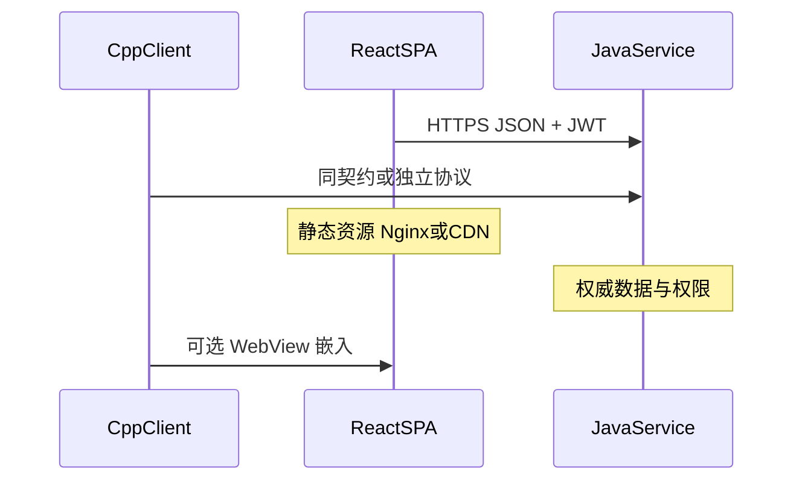

# Day2 幻灯稿：工程化、架构、三端协作（附录 · 细表）

> **课堂默认用 [00-90min-slides.md](./00-90min-slides.md)**（15 页 / 90 分钟）。本文只给备课查对照表，不要整本投影。

---

## 幻灯 23 · Day2 地图

1. 工程化对照总表（含强缓存 / 协商缓存）（70 min）
2. 路由、请求、鉴权（70 min）
3. 状态管理与「页面总管」心智（40 min）
4. 前后端与客户端协作模型（50 min）
5. 全栈路径与 2 天边界（30 min）

---

## 幻灯 24 · 工程化三列总表（整页，核心页）

| 维度 | C++ | Java | 本仓前端 |
|------|-----|------|----------|
| 工程入口 | CMake / VS | `pom.xml` | [`package.json`](../../package.json) `scripts` |
| 依赖 | vcpkg / conan | Maven Central | **npm + lockfile（锁整棵树）** |
| 构建 | 编译 + 链接 | javac + spring-boot 打包 | **Webpack via react-scripts + CRACO** |
| 产物 | exe / dll | jar / war | **`build/` 下 HTML+JS+CSS**（无 JVM） |
| 环境 | Debug / Release | profile | `NODE_ENV`、`.env`、devServer 代理 |
| 质量 | clang-tidy | Checkstyle | ESLint + Prettier（`lint` / `lint:prettier`） |
| 测试 | gtest | JUnit | **Jest + jsdom**（测函数/组件，非真机浏览器） |
| 多入口 | 多 target | 多 module | `start` / `demo` / `demo:ui`（见 scripts） |

**口播**：前端构建 = 转译 TS/JSX + 打包模块 + 压缩 + 文件名 hash，方便 CDN 强缓存。

---

## 幻灯 25 · package.json 脚本怎么读

本仓常用：

| 脚本 | 含义 | 对照 |
|------|------|------|
| `npm start` | CRACO 起开发服 | 本地 Debug 跑起来 |
| `npm run start:mock` | 带 Mock | 不连真 Java 也能画 UI |
| `npm run build` | 生产构建 | Release |
| `npm test` | Jest | 单元测试 |
| `npm run lint` | ESLint | 静态检查 |

**路径**：[`package.json`](../../package.json)

---

## 幻灯 26 · CRACO = 「不 fork Spring 的自定义 Starter」

Create React App 藏起 Webpack；公司用 **CRACO** 改配置而不 eject。

本仓 [`craco.config.js`](../../craco.config.js) 在做什么：

- 路径别名（`craco-alias` + tsconfig）
- Less + Ant Design 主题变量
- CSS Modules 命名规则
- `postcss-pxtorem`
- 开发态 Mock 类型生成、code-inspector

**对照 Java**：不想改 Spring 源码，就写 Starter / 自定义配置类。

---

## 幻灯 27 · 产物与部署差异

```text
C++:  源码 ──► 编译链接 ──► 安装包 / exe（含运行时依赖策略）
Java: 源码 ──► jar     ──► 机器上跑 JVM
前端: 源码 ──► build/  ──► Nginx / OSS 只托管静态文件
                └─ 浏览器下载后，在用户机器执行 JS
```

**关键推论**

- 前端发版可以独立于 Java（静态资源换 hash）
- **接口不兼容时**：Java 先发会直接炸旧页面 → 要契约/版本策略

---

## 幻灯 28 · 强缓存 vs 协商缓存（机制页）

浏览器拿到静态资源后，下次要不要再问服务器，由 **HTTP 缓存头** 决定。分两层：

| | 强缓存 | 协商缓存 |
|--|--------|----------|
| 白话 | 「有效期内别问我，直接用本地」 | 「先问一句：我这份还有效吗？」 |
| 常见头 | `Cache-Control: max-age=…` / `immutable`；旧站还有 `Expires` | `ETag` + `If-None-Match`；或 `Last-Modified` + `If-Modified-Since` |
| 是否发请求 | **不发**（或根本不碰网络） | **发条件请求** |
| 命中时 Network | Size = `(memory cache)` / `(disk cache)`，状态常显示 200 | **304 Not Modified**，几乎无响应体 |
| 未命中 | 过期后走协商或重新拉 | 服务器回 **200 + 新文件** |

**易混点**：`Cache-Control: no-cache` **不是「禁止缓存」**，而是「用之前必须先协商」。真正不落盘多用 `no-store`。

```text
请求静态资源
  ├─ 强缓存未过期 ──► 直接用本地（disk / memory cache）
  └─ 强缓存过期 / 未设
        └─ 带 If-None-Match / If-Modified-Since
              ├─ 没变 ──► 304，继续用本地
              └─ 变了 ──► 200 + 新内容，更新本地缓存
```

**口播**：强缓存省流量；协商缓存保证「过期后仍可能不用重下整包」。和 Java 的 Redis、本地 map 缓存不是一层东西。

**对照**

| | 对照一句 |
|--|----------|
| C++ | 强缓存 ≈ 安装目录里的 dll 一直用；协商 ≈ 启动时问更新服务「版本号变了吗」 |
| Java | Redis/本地缓存是 **接口数据**；这里缓存的是 **浏览器里的文件** |

---

## 幻灯 29 · 本仓怎么配：html 协商，hash 强缓存

`npm run build` 打出 `main.a1b2c3.js`——**内容变则文件名变**，所以 JS/CSS 可以放心强缓存很久。

```text
index.html          Cache-Control: no-cache（或 max-age 很小）
                    → 每次回来协商 / 很快过期，拿到「最新入口指向哪个 hash」
*.[hash].js/css     Cache-Control: max-age=31536000, immutable
                    → 强缓存一年；换内容 = 换 URL，旧文件名自然作废
/api/*              不要套静态资源缓存；axios + 鉴权，权威在 Java
asset-manifest.json 构建清单，浏览器入口一般不靠它；部署脚本偶尔会读
```

| Network 现象 | 含义 | 联调动作 |
|--------------|------|----------|
| `(disk cache)` / `(memory cache)` | 强缓存命中，没打到 Nginx/CDN 源 | 先确认是不是在看旧包 |
| **304** | 协商命中，服务器说「还行」 | html 常见；说明入口在问版本 |
| **200** + 体积数字 | 重新下载了 | 正常发版或未缓存 |
| html 也是 disk cache 且很久 | 入口被长缓存了 | **事故信号**：用户可能永远指旧 hash |

**发版事故典型路径**：Java 先上了新字段，Nginx 把 `index.html` 也 `max-age=7d` → 用户强缓存旧入口 → 旧 JS 调新接口 →「随机」报错。

**口播**：正规手段是 **html 短缓存/协商 + hash 换名强缓存**，不要靠口头「请用户清缓存」。Ctrl+F5 只能救自己；`Disable cache` 只对开着 DevTools 的人有效。

WebView / CS：清安装目录 ≠ 清内核 HTTP 缓存。

---

## 幻灯 30 · 依赖锁与「幽灵升级」

| | Java | 前端 |
|--|------|------|
| 直接依赖 | 你写的 version | `dependencies` |
| 传递依赖 | Maven 解析 | npm 解析出一棵大树 |
| 锁文件 | 可选 | **应提交 lockfile** |

**口播**：前端「只改了一个小包」也可能拖进一串传递依赖；CI 必须用 `npm ci` 类安装保证可复现。

---

## 幻灯 31 · 测试对照（2 天点到为止）

| | C++ | Java | 前端本仓 |
|--|-----|------|----------|
| 单测 | gtest | JUnit | Jest |
| 环境 | 本机 | Spring 测试切片 | **jsdom 假 DOM** |
| 不做（本课） | — | — | Playwright/Cypress E2E |

---

## 幻灯 32 · 路由对照

| | C++ | Java | 本仓前端 |
|--|-----|------|----------|
| 导航 | 页面栈 / 自定义协议 | `@GetMapping` | **`BrowserRouter`** |
| URL 变了发生什么 | 开新窗口或切页 | **服务端再处理请求** | **JS 换组件，不整页刷新** |
| 入口 | `main` | `DispatcherServlet` | [`src/index.tsx`](../../src/index.tsx) 挂 `Layouts` |

**口播**：地址栏变化 ≠ 浏览器重新向服务器要整页 HTML（生产仍由 Nginx 把所有路径回退到 `index.html`）。

---

## 幻灯 33 · HTTP 客户端对照

| | C++ | Java | 前端 |
|--|-----|------|------|
| 库 | libcurl / 自研 | OkHttp / RestTemplate / WebClient | **axios** |
| 横切 | 自写中间层 | Filter / Interceptor | **axios interceptors** |
| Cookie | 自己管 | 服务端 Session | 浏览器管；注意 `withCredentials` |

**本仓工厂**：[`src/utils/request/createRequest.ts`](../../src/utils/request/createRequest.ts)  
**本仓业务实例**：[`src/utils/request/request.ts`](../../src/utils/request/request.ts)

---

## 幻灯 34 · 拦截器源码对照页（建议截图上墙）

**前端在做什么（摘自本仓）**

1. **请求拦截**：塞 `Authorization: Bearer ${token}`；过期则排队并 `refreshToken`
2. **响应拦截**：
   - `data instanceof Blob` → 原样返回（下载）
   - `data.code === 401` → 弹窗去登录
   - `data.code === 200` → 返回 `data`（解包业务体）
   - 其它 code → `Promise.reject(data)`
3. **HTTP 层错误**：401/404/503/超时/断网 → 统一提示

**Java 对照**：`OncePerRequestFilter` + 全局异常处理 + 统一 `Result{code,data}`  
**C++ 对照**：统一 HTTP 封装里解析错误码，再回调 UI

完整对照代码见 [03-demo-snippets.md](./03-demo-snippets.md) Demo C。

---

## 幻灯 35 · 本仓业务契约（给 Java 对齐）

| 约定 | 说明 |
|------|------|
| 成功 | 业务 JSON 里 **`code === 200`**（不是只看 HTTP 200） |
| 鉴权 | Header `Authorization: Bearer …` |
| 登录过期 | `code === 401` 或 HTTP 401 → 清 token、跳登录；CS 嵌入态走 `CsAppManager` |
| 下载 | 响应可能是 `Blob`，拦截器单独放行 |
| Content-Type | 默认 JSON；**FormData/文件不能强行 application/json** |

**联调金句**：失败时前端「像没请求」、后端日志却有 → **第一现场在 Network**，看 CORS / 预检 / 状态码 / 响应体。

---

## 幻灯 36 · CORS / Cookie / 网关（Java 重点）

| 现象 | 常见原因 |
|------|----------|
| Console 红字 CORS | 响应缺 `Access-Control-Allow-Origin` 等 |
| OPTIONS 204 后无正式请求 | 预检失败或网关丢掉方法 |
| 有 Cookie 但带不上 | 前端 `withCredentials`、域、SameSite |
| 404 路径怪 | 网关前缀与 `API_BASE_URL` 不一致 |

本仓生产：`createRequest` 在 production 设 `Axios.defaults.withCredentials = true`。

---

## 幻灯 37 · C++ 嵌入 WebView 注意点

| 桌面程序习惯 | 浏览器/WebView |
|--------------|----------------|
| 任意读本地路径 | 需文件选择器 / 桥接 API |
| 自定义证书策略 | 受浏览器安全模型约束 |
| 直接写盘下载 | 常是 Blob → 触发浏览器下载，或 CS 桥接 |
| 同步阻塞等结果 | 前端全是异步；桥接也要回调/Promise |

本仓：`CsAppManager`（`src/utils/csapp`）—— 客户端打开页面前的初始化、登出、token 同步。

---

## 幻灯 38 · 状态管理：hox vs 单例 vs Spring

| | C++ | Java | 本仓 hox |
|--|-----|------|----------|
| 形态 | 全局单例 Manager | Spring Bean | `createStore` + Provider |
| 生命周期 | 进程级 | 容器级 | **仍挂在 React 树上，刷新丢失** |
| 事务 | 自己保证 | `@Transactional` | 无；权威在服务端 |

**口播**：不要把 hox 当成 Spring 容器；它只是「跨组件共享的 React 状态」。

**本仓**：`src/mgr/` ≈ C++ Manager 迁到 TS；与 hox 并存 —— mgr 偏命令式编排，hox 偏 UI 状态。

---

## 幻灯 39 · 「页面总管 / SDK 下沉」心智

业务演进常见路径：

```text
人肉点页面
  → 把编排抽成页面总管 / SDK API（TS）
  → 同一套逻辑给 Python 脚本 / 其它端调用
  → C++ / Java 走同一业务契约，而不是复制 UI 操作
```

**对本仓的含义**：Carsim、工作流等复杂域，前端不只是「画皮」，也可以产出 **可被自动化调用的 SDK 能力**（部分分支有 `build:carsim-sdk` / `script/carsim-sdk` 打包为 Node bundle）。  
2 天课只需建立概念：逻辑可下沉，不必永远做人肉点页面。

---

## 幻灯 40 · 三端协作时序（整页图）



---

## 幻灯 41 · 协作差异清单

| 主题 | 差异与建议 |
|------|------------|
| 版本发布 | 前端可独立发静态资源；**API 必须兼容或版本化** |
| 错误模型 | Java 异常体系 vs 前端 `code` + toast；C++ 错误码 vs `Promise.reject` —— **三端对齐错误码表** |
| 文件 | multipart 上传、Blob 下载、大结果分页 —— 最容易各写各的 |
| 实时 | 浏览器 WS + 心跳重连；对照 C++ 长连接线程、Java Netty |
| 嵌入 | CS 浏览器桥接 token/登出，与纯 Web 登录分流 |

---

## 幻灯 42 · 错误码联调清单（建议课后产出）

建议 Java + 前端共同维护一页表：

| code | HTTP | 前端行为 | Java 含义 |
|------|------|----------|-----------|
| 200 | 200 | 用 `data` | 成功 |
| 401 | 200 或 401 | 清 token / 登录 | 未登录或过期 |
| … | … | toast / 驳回 | 业务失败 |

**口播**：最坑的是 HTTP 200 但 `body.code !== 200` —— 本仓拦截器已按业务码分支。

---

## 幻灯 43 · 全栈路径：学完能做什么

**能**

- 读 TS/React 页面与 `services` 请求
- 改文案、表单、请求字段
- 用 DevTools 定位前端 vs Java
- 看懂 `package.json`、CRACO、axios 拦截器

**暂缓（别在这 2 天钻）**

- Webpack 深度定制、性能剖析
- 复杂 Canvas / 三维
- 微前端、SSR

---

## 幻灯 44 · 建议后续（不在本课）

| 角色 | 下一步 |
|------|--------|
| 全员 | 跟一个真实需求提 PR（改一处表单或文案也能练流程） |
| C++ | 嵌入页 + 桥接 API；理解 token 同步 |
| Java | 接口契约 + 错误码联调清单；CORS/网关文档 |
| 进阶 | 把页面编排抽成可脚本化 SDK |

---

## 幻灯 45 · Day2 小结三句

1. 前端产物是静态资源，**契约在 API**；**html 协商/短缓存，hash 资源强缓存**  
2. 拦截器 ≈ Filter：Bearer、`code===200`、401 去登录  
3. hox/mgr 都是会话态；**DB 只在 Java**

---

## 幻灯 46～49 · Day2 附录

### 46 工程名词

| 词 | 含义 |
|----|------|
| CRACO | 改 CRA 配置的薄封装 |
| hash 文件名 | 内容变则 URL 变，利于**强缓存** |
| 强缓存 | `max-age` 未过期直接用本地，Network 见 disk/memory cache |
| 协商缓存 | 带条件头问服务器；未变回 **304** |
| `no-cache` | 可存本地，但用前必须协商（≠ 禁止缓存） |
| `no-store` | 尽量不落盘 |
| Mock | 本地假接口 |
| jsdom | Node 里模拟浏览器 DOM |

### 47 本仓请求相关文件

```
src/utils/request/
  createRequest.ts   工厂
  request.ts         主业务实例（鉴权/刷新）
  fileRequest.ts     文件类
  pubRequest.ts      公共/未登录
  index.ts           导出
```

### 48 发布检查清单（口头）

- [ ] 接口兼容或有版本  
- [ ] 前端 `build` 产物部署到正确 CDN/Nginx  
- [ ] Nginx 对 SPA 做 history fallback  
- [ ] **`index.html` 短缓存 / `no-cache`；带 hash 的 js/css 长 `max-age`（可加 `immutable`）**  
- [ ] `/api` 未误套静态资源 Cache-Control  
- [ ] 网关 CORS / Cookie 域正确  

### 49 Q&A / 结业

回顾主线：进程可重建、UI=f(state)、静态资源+API。  
鼓励跨端结对：下周各改一个「带 Network 截图」的小 PR。
