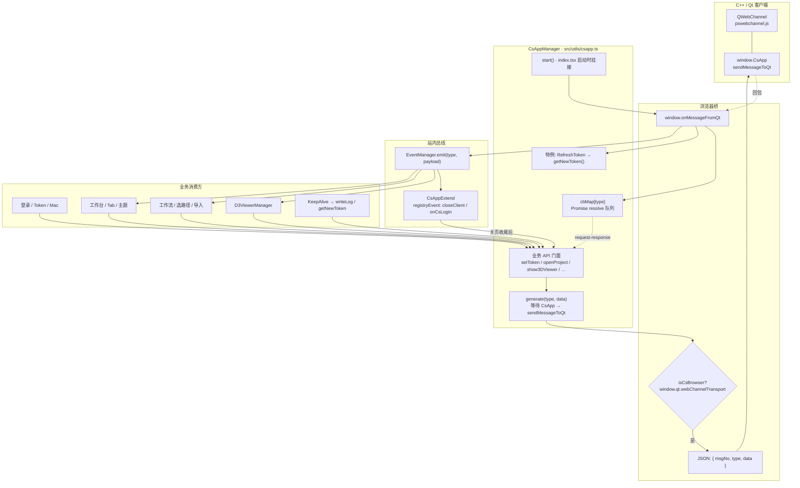

# CsAppManager 架构

> 源码：[`src/utils/csapp.ts`](../src/utils/csapp.ts)  
> 扩展：[`src/utils/csappExtend.ts`](../src/utils/csappExtend.ts)  
> 启动：[`src/index.tsx`](../src/index.tsx) 中 `CsAppManager.start()`

`CsAppManager` 是 **Web ↔ Qt/C++ 客户端** 的静态门面：只在 CS 嵌入浏览器（`window.qt.webChannelTransport` 存在）时真正发消息；纯 Web 下多数调用空过或短路。

---

## 总览



---

## 两条通路

| 方向 | 路径 | 用途 |
|------|------|------|
| **Web → CS** | 业务 API → `generate` → `window.CsApp.sendMessageToQt` → `cbMap` 等回包 | 选目录、设 Token、开项目、3D 指令等 **请求-响应** |
| **CS → Web** | `window.onMessageFromQt` →（`RefreshToken` 特判）或 `EventManager.emit` | 关页、3D 布局/进度、保存项目等 **推送事件** |

### Web → CS（请求-响应）

1. 调用方走静态方法（如 `setToken()`、`selLocalDir()`）。
2. `generate(type, data)`：若 `window.CsApp` 未就绪则短暂轮询等待。
3. 组包 `{ msgNo, type, data }`，`sendMessageToQt`。
4. 同一 `type`（或显式 `responseType`）的 resolve 推入 `cbMap`；CS 回包时 `shift` 兑现 Promise。

### CS → Web（推送）

1. `start()` 挂接 `window.onMessageFromQt`。
2. 解析 `MessageParams`，按 `type` 取 `cbMap` 兑现等待中的请求。
3. `RefreshToken` → `getNewToken()`（走 Java `refreshToken`，再 `setToken` 回写 CS）。
4. 其余 type → `EventManager.emit(type, [], payload)`，由页面 / Manager / `CsAppExtend` 订阅。

---

## 消息域（`MessageType`）

| 域 | 示例 type | 说明 |
|----|-----------|------|
| 项目 `AboutProject` | `OpenProj`、`selLocalDir`、`SaveProject`、`closeClient` | 开闭项目、本地路径、缓存目录、手册等 |
| 用户鉴权 `UserAndAuth` | `SetToken`、`GoLogin`、`GetMacAddress`、`MacAddress` | Token / 用户 / Mac / 强制登出 |
| Tab `AboutTab` | `SetTabTitle` | 改客户端 Tab 标题 |
| WebRequest | `UpdateProject` | CS 要求 Web 侧更新项目 |
| 3DViewer `D3ViewerOperation` | `show3DViewer`、`cs3DVLayoutChange`、`startSimuAnalysis` | Web↔CS 双向 3D / 联仿 |
| 配置 | `SetClientTheme`、`autoSaveSet`、`ShortcutInfo` | 主题、自动保存、快捷键 |
| 其它 `Others` | `WriteLog`、`GetClientVersion`、`SetCsModelSize` | 日志、版本、窗口尺寸 |

完整联合类型见源码顶部 `export type MessageType = …`。

---

## 关键协作对象

| 模块 | 角色 |
|------|------|
| `window.CsApp` / QWebChannel | Qt 注入的桥对象；`index.html` 在嵌入态加载 `pswebchannel.js` |
| `EventManager` | CS→Web 推送的站内分发总线 |
| `CsAppExtend` | 在 `EventManager` 上挂「关页 / 登录」可注册回调，收尾后再调 `setCloseClient` |
| `D3ViewerManager` | 订阅 `csClose3DViewer` 等，并向 CS 发 show/update/hide |
| 登录 / KeepAlive | 登录成功同步 Token/用户；心跳失败刷新 Token 或写日志 |

---

## 生命周期

```text
应用启动 (index.tsx)
  └─ CsAppManager.start()
       ├─ 挂接 onMessageFromQt
       ├─ 登录路径下清旧 ClientVersion
       ├─ getClientVersion → Local
       └─ getMacAddress → license 分流 (setFromMacPayload)

登录成功
  └─ setConfig / setUserInfo / setToken → CS

运行期
  ├─ 页面/Mgr 调 API → generate → CS
  └─ CS 推送 → cbMap 或 EventManager → 页面

关页
  └─ csCloseClient → CsAppExtend 注册回调 → setCloseClient
```

---

## 判定与注意

- **`isCsBrowser()`**：`!!window.qt?.webChannelTransport`。非 CS 环境不要假设本地选文件、3D 原生窗等能力可用。
- **`no-cache` 式等待**：`generate` 在 `CsApp` 未就绪时最多约等 30s；调用方仍应做好「纯 Web 无桥」分支。
- **与 Java 鉴权分流**：HTTP/`code === 401` 时纯 Web 走弹窗登录；CS 嵌入态常经 `CsAppManager`（如 `goLogin` / `setBeForcedLogOut`）与客户端对齐。
- **版本差异**：部分能力有 `isV1214OrEarlier()` 一类分支，改桥接协议时需对照客户端版本。
