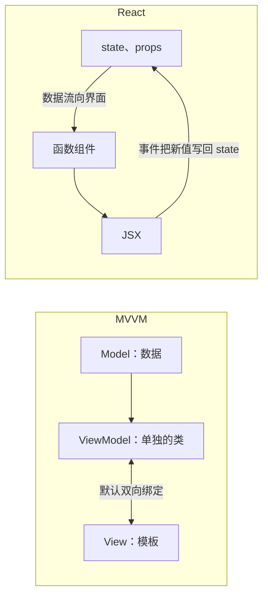

# 前端概念初识（培训大纲）

时长：90 分钟。今天从实现 CRUD 开始了解前端：员工页的列表、新建、删除已经有了，要自己上手改 demo，加字段、实现修改。

今天要会：自己上手改 demo，加字段、实现修改等简单业务功能。今天不讲：事件循环、loader 配置、装饰器、mixin、memo。

例子用 `前端概念初识-demo` 的员工页：页面在 `src/pages/employee`，构建看 `webpack.config.js`，假接口在 `server/mock.js`。

| 节 | 分钟 |
| --- | --- |
| 浏览器 | 15 |
| 构建过程 | 15 |
| TypeScript | 20 |
| Less 与 CSS Modules | 10 |
| React 组件、Props 与状态 | 20 |
| 对着员工页串一遍 | 10 |

## 1. 浏览器（15 分钟）

是什么：打开页面的程序。一个标签页里的文档在渲染进程里，JavaScript 在这条进程的主线程上执行。

解决什么问题：页面卡住、点不动时，要能指出是这份文档所在渲染进程的主线程被占住。地址栏、书签在另一个进程里，不参与算布局。

先分清进程和线程，再记页面脚本跑在哪。进程是操作系统隔开的一块，线程在进程里面。页面代码碰不到进程表，也没有 JVM。

- 浏览器进程：地址栏、书签、前进与后退。
- 渲染进程：这个标签页里的文档。不同站点可以再拆进程。不要记成「整个浏览器只有一个渲染进程」，也不要记成「每个标签一定单独一个进程」。
- GPU 进程：把画好的结果送上屏幕。
- 主线程在渲染进程里面，不和上面三个进程并列。JavaScript、HTML/CSS 解析、样式计算、布局都在这条线程上。它一次只做一件事，当前函数没返回，点击和定时器插不进来。
- 合成器线程也在渲染进程里，不在 GPU 进程里。一部分滚动可以不回主线程重做布局。

页面卡住，是这份文档所在渲染进程的主线程被占住，不是地址栏所在的浏览器进程在算布局。

CRUD 对应：列表、新建、删除的请求都由页面脚本发出，在渲染进程的主线程上执行。点按钮没反应，先看这条线程有没有被占住。

不讲：事件循环、微任务、帧预算、Worker。

## 2. 构建过程（15 分钟）

是什么：从入口 `src/index.tsx` 出发，把 `.tsx`、`.less` 转成浏览器能直接打开的静态文件。`npm run build` 写到 `dist`；`npm start` 由开发服务器在内存里现给转换后的文件。

解决什么问题：浏览器不执行 TypeScript、JSX 和 Less。源码又拆成很多文件，上线还要把脚本压短，并让改过内容的文件换名字，旧缓存才不会盖住新文件。

看文件名 hash 时，用生产构建的 `dist`。四步按这个顺序记：转译、打包、压缩、文件名 hash。

- 转译：`ts-loader` 把 TypeScript 和 JSX 变成 JavaScript。类型在检查后擦掉，产物里没有 `interface`。JSX 变成对 React 运行时的调用，不是浏览器原生标签。
- 打包：顺着 `import` 把页面、store、请求收进少数几个文件。浏览器跑的是这一份产物，不是按源码目录去拉几十个 `.ts`。
- 压缩：生产模式把 JavaScript 压短（去掉空白、缩短局部名字）。这是压源码，不是打成 zip，也不是服务器上的 gzip。开发模式不压。
- 文件名 hash：产物是 `js/[name].[contenthash:8].js`，CSS 是 `css/[name].[contenthash:8].css`。hash 跟着文件内容走，内容变了名字才变，旧缓存不会盖住新文件。入口 HTML 再指向这个新名字。

同一趟构建里，`.less` 会先编成 CSS，再把 px 换成 rem、把局部类名改写掉。换算和类名放第 4 节。

CRUD 对应：改完 `.tsx` 或 `mock.js` 后用 `npm start` 边改边看；交付前用 `npm run build` 生成 `dist`。

不讲：每一项 loader 的配置、source map、分包。

## 3. TypeScript（20 分钟）

是什么：给 JavaScript 加上类型标注。类型只在构建时检查，进浏览器之前被擦掉，运行的仍是 JavaScript。`tsconfig.json` 开了 `strict`。兼容看字段对不对得上，这叫结构化类型。

解决什么问题：函数参数、接口数据和组件 Props 的形状写错时，构建阶段就报出来。几种可能写成联合类型，用之前先收窄。页面上常见的是状态 `'在职' | '离职'`、部门可能为空、年龄可能是 `null`。类型挡不住接口真的返回了别的结构。

- 必讲：`string`、`number`、`boolean`、数组、`interface`、可选字段 `?`。
- 结构化类型：两个类型字段对得上就能赋，类型名字可以不同。传给 `createEmployee` 的对象有 `name`、`age`、`status` 这些字段就能过，不必先声明成 `Employee`。直接写出的对象多了类型里没有的字段，会在这一处报错。
- 联合类型：`A | B` 表示这个值是 A 或 B 里的一种。员工状态是 `'在职' | '离职'`。`dept?: string | null` 读出来是 `string | null | undefined`。年龄是 `number | null`。
- 类型收窄：联合类型先判断，过了判断类型就变窄。`deptLabel` 里 `dept == null` 时返回「未分配」，这条 return 之后 `dept` 只剩 `string`。`save` 里 `values.age == null` 就 return，后面的 `values.age` 是 `number`，才能交给 `createEmployee`。`status === '在职'` 的分支里只剩这一个字符串。
- 函数参数和返回值写类型。`strict` 下 `null` 和 `undefined` 先收窄再用：空部门显示「未分配」，空年龄不能当数字提交。
- 组件的 Props 是父组件传下来的对象，`interface` 描述它的形状，Props 本身不是类型。`UserCard` 的 `name` 必填，`status?` 可以不传。传进去的对象字段对得上就能用。
- `request<Employee[]>` 里的 `Employee[]` 只说明返回的业务数据是什么形状。拦截器在业务成功时取出 JSON 里的 `data` 交出去，页面拿到的不是带 `status`、`headers` 的原始 HTTP 响应。类型挡不住接口真的返回了别的结构。

CRUD 对应：加字段要同时改 `Employee` 类型、表单的 `Draft`、表格列和 mock 数据。类型能在漏改的地方报错，但接口真实返回的数据还要自己核对。提交前先把年龄、部门从联合类型收窄成能用的那一种。

不讲：装饰器、条件类型、手写声明文件。

## 4. Less 与 CSS Modules（10 分钟）

是什么：Less 是带变量和嵌套的 CSS，编译之后仍是普通 CSS。CSS Modules 是构建时把本文件的类名改成带文件名和 hash 的名字，模板里用 `styles.link` 取到它。

解决什么问题：颜色不用在每个文件里抄一遍，选择器也不用每次写全。不同组件都写 `.link` 时，样式不会互相盖住。尺寸按 px 写，构建时换成 rem，页面里不用自己换算。

- Less 是 CSS 加上变量和嵌套，编译之后仍是普通 CSS。颜色收在变量里，例如 `@PsPrimaryColorNormal`。嵌套只是少写选择器，不会让类名变成局部的。
- 组件旁放 `index.less`，用 `import styles from './index.less'`，模板里写 `className={styles.link}`。不要写字符串 `"link"`。
- CSS Modules 在构建时把局部类名改成带文件名和 hash 的名字，只作用在本组件，别的页面写 `.link` 盖不住它。全局样式仍会互相盖，这节只留组件自己的 `index.less`。
- 尺寸按 px 写。换算不在页面入口，而在 `.less` 的构建链上：`postcss-pxtorem` 的 `rootValue` 为 100，源码里的 `100px` 变成产物里的 `1rem`。只处理 `.less`，`global.css` 和组件库的 CSS 不走这条规则。浏览器里已经是 rem，不是运行时再用脚本换。

CRUD 对应：新加的表单项或按钮样式写在 `index.less` 里，用 `styles.xxx` 取类名，尺寸仍按 px 写。

不讲：mixin 大全、全局样式方案。

## 5. React 组件、Props 与状态（20 分钟）

是什么：用函数描述界面。函数根据当前数据返回 JSX；数据变了，函数再执行一次，对应的一块界面重画。

解决什么问题：列表、筛选词、弹窗开闭一变，不用手改页面上的节点。父组件用 props 把姓名、状态传给子组件；组件自己会变的数据放在 state；进入页面后再去请求列表。

用三个词对照员工页，帮助记住谁管数据、谁管界面：

- Model：`list`、`keyword`、`open` 这些数据。
- View：`return` 里的 JSX，负责界面结构。
- ViewModel：`EmployeePage` 这个函数。它用数据算出要画什么，用 `onClick`、`onChange` 接住操作，再改数据。

React 没有单独的 ViewModel 类，也没有默认的双向绑定。输入框要自己把 `value` 指到状态，再用 `onChange` 写回去。数据从状态流向界面，事件再把新值送回来。用这三个词记职责，不要记成「React 就是一套 MVVM 框架」。

页面上接着看这几件事：

- 组件是函数，执行一次返回 JSX。JSX 写界面结构，大括号里放表达式。
- 父给子传 props。`UserCard` 收到姓名、状态和选中回调。列表用 `map`，每项的 `key` 用稳定的 `item.id`，不要用数组下标。事件写 `onClick`，不是 `onclick`。
- 组件自己会变的数据用 `useState`：筛选词 `keyword`、弹窗开闭 `open`。改状态用新值替换，界面才会重画。
- 进入页面要请求列表，放在 `useEffect` 里调用 `loadList`。依赖数组这次不展开。
- 本仓跨组件状态用 hox。这个功能内是 `src/store/employee.ts` 的 `createStore`，全站是 `src/store/global.ts`。页面里只调用 `useEmployeeStore`、`useGlobalStore`。这里只回答「状态放哪里」。

CRUD 对应：列表靠 `useEffect` 调 `loadList` 取数；新建和修改共用一个弹窗，`open` 控制开关；修改时正在编辑的那条 id 也放在 state 里。

不讲：`memo`、依赖数组的细节、`forwardRef`、双向绑定库。

## 6. 收尾（10 分钟）

是什么：不讲新概念。打开员工页，把前五节接到同一条线上。

解决什么问题：进程、构建、类型、样式、组件分开记过之后，要能在这一个页面上对上号：脚本跑在哪、浏览器拿到的是什么文件、类型和类名何时处理掉、界面由哪份数据算出来。

打开员工页，按这条线走一遍：脚本跑在渲染进程的主线程上；浏览器拿到的是转译、打包、压缩并带 contenthash 的产物；类型和局部类名在构建时处理掉；页面是一个函数，用状态算出 JSX，进入页面后再请求数据。

## 7. 动手练习（课后或另留时间）

员工页已有列表（R）、新建（C）、删除（D），没有修改（U）。下面两个练习按顺序做。

练习一：加字段
1. `Employee` 类型（来自 `@/services/employee`）加 `email?: string`，`Draft` 同样加上。
2. 弹窗里加一个 `Form.Item name="email"`，表格 `columns` 加一列。
3. `server/mock.js` 的 `employees` 里给一条数据补上 `email`。

完成标准：新建员工时能填邮箱，列表里能看到。

练习二：实现修改
1. 表格「操作」列加「编辑」按钮。点击时用 `form.setFieldsValue` 把该行填进弹窗，标题改成「编辑员工」，并把正在编辑的 id 存进 state。和删除一样要 `event.stopPropagation()`，否则会同时选中这一行。
2. `save` 区分新建和修改：新建走 `createEmployee`，修改走新增的 `updateEmployee`，请求 `PUT /api/employees/:id`。
3. `server/mock.js` 仿照 DELETE 的写法加 PUT 路由：按 id 找到员工、替换数据，再返回 `{ code: 200, data }`。当前的 DELETE 只匹配 `/employees/:id`，PUT 不会自动生效。

完成标准：编辑保存后，列表里这一行变了。
