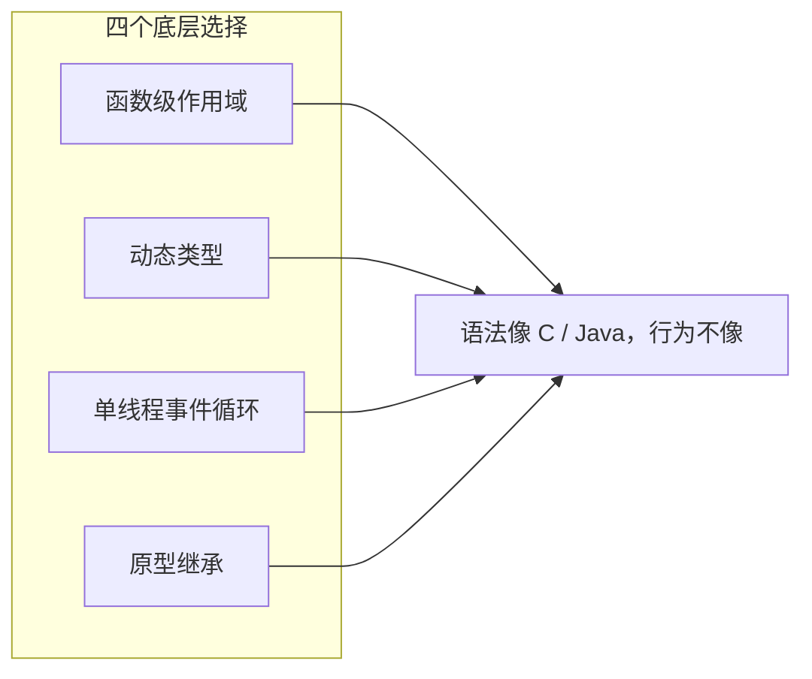
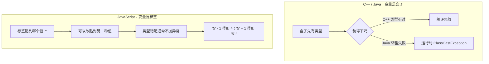
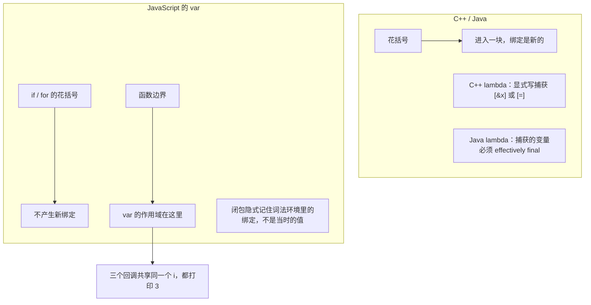
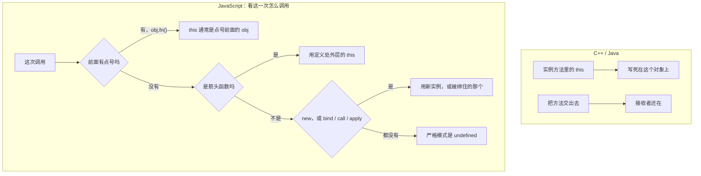
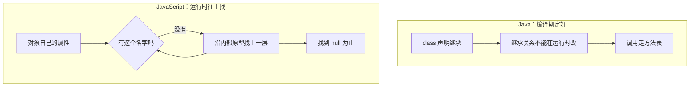
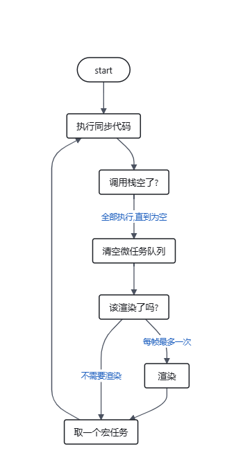
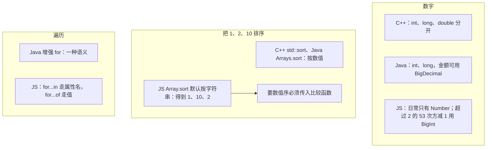
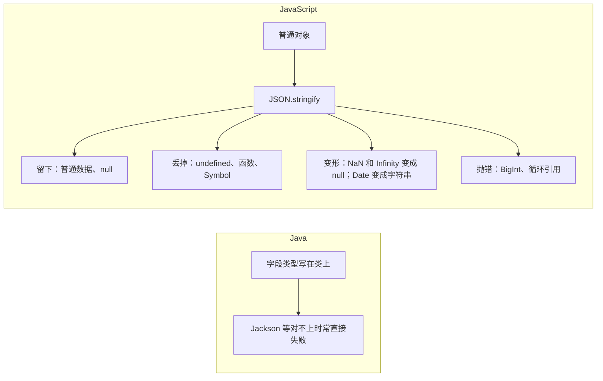
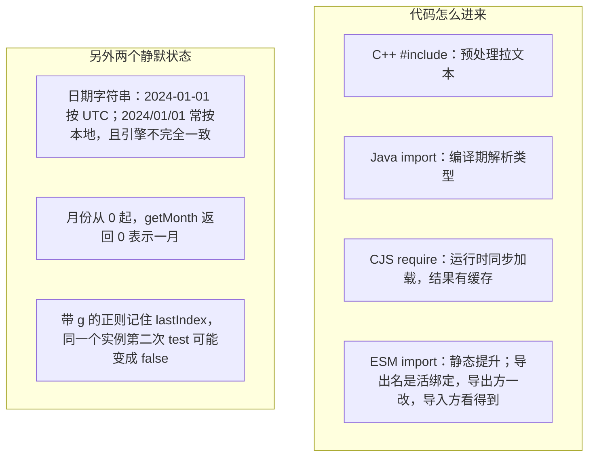

# 第三课：JavaScript——当你的直觉开始骗你

给有 C++/Java 背景的同事讲前端。前两课已建立基础页面与工程概念，第三课聚焦 JS 中"看起来像 C/Java，实际行为完全不同"的地方。他们踩坑通常不是因为语法陌生，而是因为语法"长得太像"，导致误用了静态语言的心智模型。

本课不要求记住所有怪异行为，而是建立一套"遇到不确定时知道往哪个方向查"的判断框架。每个模块先投对照图，再跑一两个会静默出错的例子。

## 分讲安排

图只服务当场要记住的那一个反差，不把附录里的边角画进去。第 2 次只讲 `this`、原型和事件循环。数字、JSON、模块放到第 3 次。

| 次 | 模块 | 带走的判断 | 时长 |
| --- | --- | --- | --- |
| 第 1 次 | 开场、模块一、模块二 | 值没有类型盒子；`var` 的花括号是装饰；闭包记住的是绑定 | 约 90 分钟 |
| 第 2 次 | 模块三至五 | `this` 看调用点；属性沿原型找；异步是排队，`try/catch` 抓不住回调 | 约 95 分钟 |
| 第 3 次 | 模块六至八、结尾 | 数字和 `sort` 规则不同；JSON 会丢字段；模块、日期、正则各有一条守则 | 约 90 分钟 |

---

# 第 1 次 · 值和作用域

| 段 | 时长 | 讲什么 |
| --- | --- | --- |
| 开场 | 8 分钟 | 四个底层选择，本课只建立查的方向 |
| 模块一 | 40 分钟 | 标签不是盒子。`===`、两个空、假值。其余转换只留守则 |
| 模块二 | 35 分钟 | 现场跑 `var` 循环。`const` 只冻绑定 |
| 收束 | 7 分钟 | 用对照图各复述一句 |

## 开场：一句话定位本课

先抛一个判断：JS 的很多"奇怪设计"不是随机 bug，而是 **函数级作用域 + 动态类型 + 单线程事件循环 + 原型继承** 这四个底层选择叠加后的必然结果。第 1 次只碰前两个，后两个在第 2 次。



## 模块一： 动态类型

**核心反差**：C++/Java 的变量有类型，盒子决定能装什么；JS 的变量没有类型，标签贴到哪个值上，它就是什么。同一变量可以先 `let x = 1` 再 `x = "hello"`，运行时不报错。

### 和其他语言的对照



讲的时候指右边：错了往往不是崩，而是算出一个还能往下用的值。

### 子话题

- **typeof 的失真**：`typeof null === "object"` 是初版引擎的类型标记遗留问题；`typeof NaN === "number"`。不要用 `typeof` 做严谨类型判断。
- **`==` 的传递性陷阱**：`0 == ""` 为 true，`"" == false` 也为 true，但整个链条缺乏可预测的传递规则。结论只有一条：默认永远用 `===`，除非你有明确理由使用 `==`。
- **真值/假值表**：`0`、`""`、`null`、`undefined`、`NaN`、`false` 是假值，其余为真值。C++ 中 `if (1)` 合法且直观，Java 中 `if (1)` 直接编译错误；JS 中 `if ("0")` 是 `true`，这是从静态语言过来后最容易误判的条件分支之一。
- **undefined 与 null**：`undefined` 通常是"语言替你留下的空白"（未赋值、属性不存在、无返回值）；`null` 通常是"你主动放置的空值"。工程上建议对外接口返回 `null` 表示"明确的空"，内部用 `undefined` 承接语言行为，不要混用。
- 隐式转换（强制转换）
- **Object.is 与 NaN / -0**（点到，不展开演示）：
  - `NaN !== NaN`，判断用 `Number.isNaN(x)`，不要用全局 `isNaN`（后者会隐式转换，`isNaN("abc")` 为 true）。
  - `Object.is(NaN, NaN)` 为 true；`Object.is(0, -0)` 为 false，但 `0 === -0` 为 true。
  - `Map` / `Set` 使用 SameValueZero：NaN 等于自身，0 等于 -0。
- **parseInt / Number / 一元 + 的区别**：
  - `parseInt("12px")` 返回 `12`，`Number("12px")` 返回 `NaN`。
  - `parseInt` 始终传第二个参数 radix：`parseInt("08", 10)`。
  - 一元 `+` 等价于 `Number()`，会触发 `valueOf` / `toString`。
  - > **一句话守则**：严格转换用 `Number()`，解析前缀用 `parseInt(str, 10)`，不要依赖隐式转换。
- **字符串与 Unicode**（点到）：
  - `"😀".length === 2`，因为 JS 字符串是 UTF-16 码元序列，emoji 占两个码元（代理对）。
  - `Array.from("😀").length === 1`，按码点拆分；`codePointAt` 取码点；`Intl.Segmenter` 按字素（用户感知字符）拆分。
  - 截断字符串、计算用户输入长度、处理 emoji 时必踩。
- **Symbol 简述**（点到）：唯一值，用作属性键避免冲突；`Symbol.iterator` 等内置符号是协议钩子；`Symbol.for` 是全局注册表。对 Java 的 enum 有类比，但 Symbol 是运行时值，不是类型。

> **给他们的对比锚点**：Java 的 Object 转型失败会在运行时抛 `ClassCastException`；JS 不会，类型错配往往不抛异常，而是安静地产生一个不符合预期的值。

## 模块二：变量、作用域与闭包——var 是一场"函数级幻觉"

**核心反差**：C++/Java 的 `{}` 创造块级作用域；`var` 不认 `{}`，只认函数边界。`if` 和 `for` 的花括号在 `var` 面前几乎是装饰性的。

### 和其他语言的对照



左边强调"你得写明捕获什么"。右边强调"不写也会记住，而且记住的是那一个变量，不是一份拷贝"。

### 子话题

- **变量提升**：`console.log(x)` 在 `var x = 1` 之前输出 `undefined`，而不是报错。声明被"提升"了，赋值没有。
- **经典闭包循环陷阱**：

  ```js
  for (var i = 0; i < 3; i++) {
    setTimeout(() => console.log(i));
  }
  ```

  输出三个 `3`，因为三个回调共享同一个 `i`。用 `let` 后每次迭代创建新绑定，输出 `0, 1, 2`。这个例子直接现场演示。

- **let / const 的暂时性死区**：在声明之前访问 `let` / `const` 变量会抛 `ReferenceError`，而不是 `undefined`。这比 `var` 更接近他们的静态语言直觉，但报错时机仍然是运行时。
- **闭包：从"循环陷阱"升级为系统概念**：
  - 闭包捕获的是变量绑定，不是值。循环陷阱的本质是三个回调共享同一个 `i` 绑定，而不是"闭包记住了旧值"。
  - 工程含义：闭包可以做私有状态、模块模式、柯里化；但也容易导致内存泄漏——定时器、事件监听、缓存如果闭包持有了大对象，GC 回收不掉。
  - > **一句话守则**：闭包不是魔法，是函数记住了它定义时的作用域；需要"每次迭代独立"时，用 `let` 或显式工厂函数。
- **const 不是 C++ 的 const，也不是 Java 的 final**：
  - `const obj = {}` 之后 `obj.x = 1` 完全合法。`const` 只冻结绑定，不冻结值。
  - 要冻结对象内容用 `Object.freeze(obj)`，但它是**浅冻结**：嵌套对象仍可改。深冻结需要递归或库。
  - 属性还有 `writable` / `enumerable` / `configurable` 三个描述符，`Object.defineProperty` 可以精细控制；`Object.seal` 禁止增删属性但允许改值；`Object.preventExtensions` 只禁止新增。本讲只提名字，不演示。
  - 对比锚点：Java 的 `final` 字段如果指向对象，对象内容同样可变，但 Java 有 `Collections.unmodifiableList` 等包装；JS 没有编译期约束，全靠运行时 API 和约定。
- **arguments 与剩余参数**（一句）：`arguments` 是类数组，箭头函数没有它；剩余参数 `...args` 是真数组。新代码用剩余参数。

> **一句话守则**：新代码中默认 `const`，需要重新赋值时用 `let`，不要再用 `var`。

---

# 第 2 次 · this、原型与事件循环

承接第 1 次：学员能分清标签和盒子，知道 `var` 循环共享的是同一个绑定。

| 段 | 时长 | 讲什么 |
| --- | --- | --- |
| 模块三 | 25 分钟 | 不背四条规则，只问调用点有没有点号 |
| 模块四 | 20 分钟 | 查找链、别漏 `new`、字典用 `Map`。私有字段只点名 |
| 模块五 | 40 分钟 | 先猜 `1 4 3 2`，再讲 `try/catch` 抓不住回调 |
| 收束 | 10 分钟 | 六句话复述。练习只标这三块，不对答案 |

## 模块三：this——它不指向"当前对象"，它取决于"谁调用"

这是 C++/Java 同事最容易出现系统性误解的地方。在 Java/C++ 中，`this` 在实例方法中含义明确，就是当前实例；JS 的 `this` 由调用方式在运行时决定。

### 和其他语言的对照




### 子话题

- **四种绑定规则**（按优先级从高到低，图里已经是提问顺序，不必背）：`new` 绑定 → 显式 `bind` / `call` / `apply` → 方法调用 `obj.fn()` 中的 `obj` → 默认绑定（严格模式下 `undefined`，非严格模式下全局对象）。
- **丢失 this 的经典场景**：`setTimeout(obj.method, 100)`。修法是箭头函数包一层，或事先 `bind`。不要为了讲规则再写第四种写法。
- **箭头函数是"解药"也是"特例"**：箭头函数没有自己的 `this`，它捕获定义时外层作用域的 `this`。用它写回调通常能绕开绑定问题，但不要用箭头函数定义对象方法——此时 `this` 不会指向该对象。

**讲授策略**：反复问"这个函数被调用时，前面有点号吗？"

## 模块四：原型——不是"类"的语法糖（至少不完全是）

Java 的继承是编译期的类型扩展；JS 的原型查找是运行时的属性查找链。即使 ES6 引入了 `class` 语法，底层仍然是原型，而且运行时可以修改原型链。

### 和其他语言的对照



空对象不空，就是因为右边这条链的底是 `Object.prototype`，上面有 `toString`、`hasOwnProperty`。所以不要拿 `{}` 当哈希表，字典用 `Map`。

### 子话题

- **分清 `[[Prototype]]` 和 `Fn.prototype`**：
  - 每个对象内部有一条 `[[Prototype]]`。读属性时顺着它往上找。`Object.getPrototypeOf(obj)` 看到的就是这条链，实例上通常没有 `.prototype` 这个字段。
  - `Fn.prototype` 是函数对象上的一个普通属性。`new Fn()` 时，新对象的 `[[Prototype]]` 被设成 `Fn.prototype`。它是准备给所有实例共用的那张方法桌，不是「这个函数的父类」。
  - 对照：Java 的方法在类的方法表里，实例不各自拷一份。JS 把这张表放在构造函数的 `.prototype` 上，再让每个实例的 `[[Prototype]]` 指过去。
  - 常见看错：去实例上找 `.prototype`，得到 `undefined`。`.prototype` 在函数上，`[[Prototype]]` 在实例上。
- **`obj.foo` 的查找路径**：先找自身属性，找不到沿 `[[Prototype]]` 向上找，直到 `null`。赋值 `obj.foo = 1` 写在自己身上，不会去改原型上的同名属性，除非这个属性是 setter。运行时可以增删属性，所以同一段查找代码，前后结果可以不同。
- **构造函数、`new`、`.prototype`**：
  - `new Fn(args)` 大致四步：造一个新对象；把它的 `[[Prototype]]` 设为 `Fn.prototype`（若那不是对象，则用 `Object.prototype`）；用这个新对象当 `this` 调用 `Fn`；若 `Fn` 返回的是对象，`new` 的结果就是那个返回值，否则是刚造的新对象。
  - 方法挂在 `Fn.prototype` 上，实例只留各自的数据。挂在 `this.method = ...` 上会每个实例拷一份。
  - `Fn.prototype.constructor` 默认指回 `Fn`。它是普通属性，`new` 不读它。改掉 `constructor`，`new Fn()` 照样用你写下的那个函数。
  - 函数也是对象，可以挂自己的属性。`Fn.staticLike = 1` 在函数身上，实例的查找链上看不到。
  - 非严格模式下，普通函数忘了 `new`，`this` 会落到全局对象，调用「成功」但污染全局。`class` 不用 `new` 会直接抛错。两句不要并成一句。
- **继承（ES5 心智）**：
  - 子构造函数要做两件事，缺一不可：`Child.prototype = Object.create(Parent.prototype)`，让实例的查找链接到父原型；在 `Child` 里 `Parent.call(this, ...)`，把父构造函数的初始化跑在这个 `this` 上。
  - 接上原型之后把 `Child.prototype.constructor = Child` 写回去。不写的话，`constructor` 会沿着链指到 `Parent`。这只影响读这个属性的人，不影响 `new Child()`。
  - `instanceof` 看的是右边函数的 `.prototype` 在不在左边对象的 `[[Prototype]]` 链上，不看 `constructor` 属性。
  - 不要写 `Child.prototype = new Parent()`。那会把父构造函数跑一遍，父实例上的数据字段会变成所有子实例共享的原型属性。
  - 对照：Java 的 `extends` 在编译期定好，子类构造必须先调 `super`。ES5 是运行时把两张原型桌接起来，漏接时代码仍能跑，只是方法找不到。
- **`class` / `extends`**：
  - `class` 仍是上面这套：实例方法放在 `.prototype` 上，而且默认不可枚举；`extends` 把 `Child.prototype` 的 `[[Prototype]]` 接到 `Parent.prototype`，同时把 `Child` 这个函数的 `[[Prototype]]` 接到 `Parent`，所以静态方法也靠查找链继承。
  - 派生类的构造函数里，用 `this` 之前必须先 `super(...)`。这是语法规定，不是运行时才发现的静默错误。
  - `#private` 字段是真正的私有，不是 `_` 约定，类外和子类都看不见。`static` 块用来初始化静态字段。`new.target` 指向真正被 `new` 的那个构造函数，父类里可以用它区分是不是子类在构造。
  - 语法糖底下仍能改原型。`instanceof` 走的还是原型链。讲完要求学员能在 `class` 写法里指出：方法在哪张桌上，`extends` 接了哪两条链。


## 模块五：异步与错误处理——没有多线程，只有事件循环

这是与 C++/Java 差异最大的一部分。他们习惯的并发模型是线程、锁、join；JS 主线程严格单线程，异步是"排队"而不是"并行"。

### 和其他语言的对照


把预测题标在这张图上：同步打印 `1` 和 `4`，微任务打印 `3`，宏任务打印 `2`。`Promise.then`、`queueMicrotask`、`await` 之后的代码是微任务；`setTimeout`、DOM 事件、I/O 回调是宏任务。

### 子话题

- **一个必须现场跑的预测题**：

  ```js
  console.log("1");
  setTimeout(() => console.log("2"), 0);
  Promise.resolve().then(() => console.log("3"));
  console.log("4");
  ```

  输出 `1 4 3 2`。先让他们写，再跑。

- **运行时三件套：调用栈、堆、事件循环**：
  - **调用栈**：当前这段同步调用叠在一起，和 C++ / Java 的一条线程栈是同一幅图。浏览器里跑页面 JS 的栈只有这一条。栈没清空时，点不了下一次点击，也取不了队列里的任务。
  - **堆**：对象和闭包记住的绑定住在这里，没人引用之后由 GC 收走。闭包还指着，就收不走。这和 Java 堆一样，差别是 JS 主线程只有一条栈在用这片堆。
  - **事件循环**：栈空了以后才从队列取任务，取到的回调又压回这条栈上跑。计时器到点、网络收包可以发生在浏览器自己的线程里，但回调里的 JS 仍回到这条栈。没有「再开一条 Java 线程处理响应」。
  - 对照：Java 每个请求可以有自己的栈，多条栈同时在跑。这里多出来的是队列，不是第二条 JS 栈。
- **微任务和宏任务**：
  - 每一轮的顺序固定：当前同步代码跑完 → 把微任务队列清空（清空过程中新排进来的微任务也算这一轮）→ 取**一条**宏任务 → 再清空微任务。布局和绘制夹在宏任务之间，不插进微任务队列里面。
  - 完整的一轮见下图：渲染那一步只在「该渲染了吗」为真时进入，且每帧最多一次。

  
  - 微任务：`Promise` 的 `then` / `catch` / `finally`、`queueMicrotask`、`async` 函数里 `await` 之后的续体。宏任务：`setTimeout` / `setInterval`、I/O 回调、点击等 UI 事件。
  - 预测题就落在这张顺序上：`1` 和 `4` 是同步，`3` 是微任务，`2` 是宏任务。`setTimeout(..., 0)` 只是排到宏任务队尾，不是并行。
  - 微任务若不停地再排微任务，下一轮宏任务和绘制会一直轮不上。这是「队列没停」，不是死锁。
- **工程陷阱**：
  - `await` 忘记写，拿到的是 Promise 而不是值；
  - `forEach` 不等待异步回调，需要顺序异步时用 `for...of`；
  - `Promise.all` 是快速失败，一个 reject 整体 reject，需要"全部结果"时用 `Promise.allSettled`。
- **错误处理模型**：只有一种异常，且 `try/catch` 抓不住异步。
  - Java 有 checked / unchecked 之分，C++ 有 `noexcept`，JS 只有一种运行时异常，且没有编译期检查。
  - `throw` 可以抛任何值：字符串、数字、普通对象都行，不一定是 `Error`。工程上应始终抛 `Error` 或其子类，否则堆栈信息会丢。
  - `try/catch` 只能捕获同步代码中的异常。`setTimeout(() => { throw new Error() })` 里的异常不会进入外层 `catch`，而是触发全局 `error` 事件（浏览器）或 `uncaughtException`（Node）。Promise 中的异常需要 `.catch` 或 `unhandledrejection` 处理。
  - `Error` 的 `cause`：`new Error("msg", { cause: originalError })` 可以保留错误链，比 Java 的 `initCause` 更轻量。本讲点一句。
  - `AggregateError`：`Promise.any` 全部失败时抛出。知道名字即可。

> **一句话守则**：同步错误用 `try/catch`，Promise 错误用 `.catch` 或 `await` + `try/catch`，回调风格 API 的错误通常作为第一个参数传入（Node 风格）。

> **一句话守则**：不要在 JS 里找"线程安全"的答案；先问这段代码在事件循环的哪一步执行。

---

# 第 3 次 · 数字、JSON、模块与日期

承接第 2 次：学员能判断 `this`、沿原型找属性、说出 `1 4 3 2`。

| 段 | 时长 | 讲什么 |
| --- | --- | --- |
| 模块六 | 25 分钟 | 一种数字、`sort` 的比较函数、`for...of` |
| 模块七 | 30 分钟 | JSON 丢什么，`??` 和 `\|\|`，可选链要逐级写 |
| 模块八 | 20 分钟 | 两套模块各一句；日期和正则各一个反例 |
| 收束 | 15 分钟 | 发这一讲的速查。练习布置下去，不对答案 |

## 模块六：数字、数组与遍历——看起来一样，规则不一样

### 和其他语言的对照



`0.1 + 0.2 !== 0.3` 不是 JS 独有的，但 JS 没有开箱的小数类型，所以业务里直接看见。钱用整数分，或单独的 decimal 库，不要用 `Number` 做精确相等。

### 子话题

- **数字只有一种**：IEEE 754 双精度。超过 `2^53 - 1` 的整数会丢精度，需要 `BigInt`。
- **Array.sort() 默认按字符串排序**：`[1, 2, 10].sort()` 得到 `[1, 10, 2]`。数值序写 `(a, b) => a - b`。
- **突变方法 vs 不可变习惯**：`sort` / `reverse` / `splice` / `push` 会修改原数组；ES2023 的 `toSorted` / `toReversed` / `toSpliced` 返回新数组。业务代码优先用不改原数组的写法。
- **for...in vs for...of**：
  - `for...in` 遍历可枚举属性名，包括原型链上的，顺序不要依赖。不要用它遍历数组。
  - `for...of` 遍历可迭代对象的值：数组、字符串、`Map`、`Set`、生成器。
  - 遍历普通对象用 `Object.keys` / `Object.values` / `Object.entries`。
  - > **一句话守则**：数组和可迭代对象用 `for...of`，对象用 `Object.entries`，`for...in` 基本只在调试时用。
- **稀疏数组**（一句）：`Array(3)` 是三个空槽，不是三个 `undefined`；`map` 会跳过空槽。要三个 `undefined` 用 `Array.from({ length: 3 })`。

## 模块七：对象、JSON 与解构——前后端交互的高频静默错误

### 和其他语言的对照



对象里的 `undefined` 字段会被丢掉；数组里的 `undefined` 会变成 `null`。两种"没有"到了 JSON 里不是同一种结果。Java 同事若用 Long 的 JSON 数字对接，精度问题在模块六已经讲过，这里只提醒：长 id 在契约里用字符串。

### 子话题

- **JSON 的坑**：
  - 自定义序列化用对象的 `toJSON`；自定义反序列化用 `JSON.parse(text, reviver)`。
  - `JSON.parse` 的 `__proto__` 键在现代引擎中不会直接污染原型，但深合并解析结果时仍可能引入原型污染。知道风险即可。
  - > **一句话守则**：JSON 不是 JS 对象的完整镜像，序列化前先问"哪些字段会消失或变形"。
- **解构、展开、可选链、空值合并**：
  - 解构 `null` / `undefined` 会抛错：`const { a } = null` 直接 `TypeError`。对上 Java 的拆箱空指针，但这里是解构这一步就抛。
  - 默认值只在 `undefined` 时生效：`const { a = 1 } = { a: null }` 得到 `null`，不是 `1`。
  - 展开是浅拷贝：嵌套对象仍是共享引用。
  - `?.` 只停在写了问号的那一层。`obj?.a.b` 在 `obj` 为空时得到 `undefined`；若 `obj` 有值而 `a` 是 `null`，读 `.b` 仍会抛。要逐级写成 `obj?.a?.b`。
  - `??` 与 `||`：`||` 把 `0`、`""`、`false` 也换成右边；`??` 只在 `null` 和 `undefined` 时才换。`0 ?? 1` 是 `0`，`0 || 1` 是 `1`。

## 模块八：模块系统、日期与正则——其他高频坑

### 和其他语言的对照



### 子话题

- **模块系统**：
  - CommonJS：`module.exports` 和 `exports` 起初指向同一对象，把 `exports` 重新赋值为另一个对象会断开。顶层 `this` 是 `module.exports`。
  - ESM：顶层 `this` 是 `undefined`；`import()` 动态导入返回 Promise。
  - `package.json` 的 `"type": "module"` 决定 `.js` 按 ESM 还是 CJS 解析。循环依赖时两者行为不同，ESM 可能拿到尚未初始化的绑定。
  - > **一句话守则**：新项目用 ESM；看到 `require` 和 `module.exports` 知道是 CJS；不要混用。
- **日期与正则**：
  - `Date` 对象可变，`setDate` 改的是原对象。日期用 ISO 字符串并写明时区，不要依赖无时区字符串的默认解析。
  - 带 `g` 的正则要么每次新建，要么用完把 `lastIndex` 设回 `0`。
  - > **一句话守则**：日期用 ISO 字符串加明确时区；正则带 `g` 时不要复用同一个实例做多次 `test`。

## 结尾：从旧语言迁移到 JS 的速查

第 3 次用这一页收齐本讲的守则，并口头点一下第 1、2 次已经带走的比较、声明、`this`、原型和异步。不新开话题：

- 默认 `===`，不写 `==`。
- 默认 `const`，需要重新赋值用 `let`，不写 `var`。
- `const` 只冻结绑定，不冻结值；`Object.freeze` 是浅冻结。
- `this` 看调用点，箭头函数看定义处的外层。
- 属性沿原型找；字典用 `Map`。
- 异步先问微任务还是宏任务；`try/catch` 抓不住异步回调里的异常。
- `sort` 数字必须传比较函数。
- 数字没有整型；超过安全整数用 `BigInt`；钱用整数分或 decimal 库。
- JSON 会丢掉 `undefined`、函数、Symbol；`NaN` 会变成 `null`。
- 数组用 `for...of`，对象用 `Object.entries`。

课后练习分两次布置。第 2 次只标丢失的 `this`、`new Parent()` 当原型、以及 `1 3 2` 的输出顺序。第 3 次再标 `==`、数字 `sort`、JSON 丢字段、带 `g` 的正则第二次 `test`。练习对答案不占当场的收束时间。

## 附录 A：三次里已经盖住的三条

原先如果只有 10 分钟加餐，优先讲这三条。现在它们分别在三次正文里，不必再加一场：

1. `const` 不等于不可变，`Object.freeze` 是浅冻结。在第 1 次模块二。
2. `try/catch` 抓不住异步回调里的异常。在第 2 次模块五。
3. JSON 序列化会丢字段、改字段。在第 3 次模块七。

## 附录 B：留给后续课

这些不属于本课的语言反差，大纲里不排进 90 分钟：

- **DOM 与事件模型**：冒泡、捕获、事件委托、`passive`、`AbortSignal`。`focus` 不冒泡，`focusin` 冒泡。
- **浏览器环境与网络**：`fetch` 只在网络失败时 reject，4xx/5xx 要看 `response.ok`。另有 CORS、`AbortController`。
- **安全**：XSS、CSRF、CSP。`textContent` 与 `innerHTML` 的差别。
- **TypeScript**：类型收窄、`unknown` 与 `any`、`satisfies`、泛型。
- **构建与打包**：Vite、Webpack、tree shaking、code splitting。
- **框架**：React / Vue 的响应式，以及不要就地改数据。
- **Node.js**：`process`、`fs`、流、`worker_threads`。
- **测试**：Jest / Vitest、mock。
- **性能**：重排重绘、`requestAnimationFrame`、节流与防抖。
