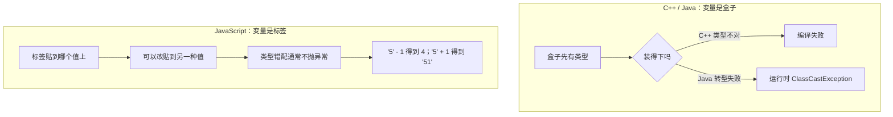

# 模块一： 动态类型


**核心反差**：C++/Java 的变量有类型，盒子决定能装什么；JS 的变量没有类型，标签贴到哪个值上，它就是什么。同一变量可以先 `let x = 1` 再 `x = "hello"`，运行时不报错。

### 和其他语言的对照



讲的时候指右边：错了往往不是崩，而是算出一个还能往下用的值。

### 子话题

- 原始值 vs 引用值: js或者说动态类型的语音，可以简单理解为，他们的类型其实在描述的是等号右边

- **typeof 的失真**：`typeof null === "object"` 是初版引擎的类型标记遗留问题；`typeof NaN === "number"`。不要用 `typeof` 做严谨类型判断。
- **隐式转换**：代码没写 `Number()` / `String()` / `Boolean()`，求值时语言仍会调用这三条运算。显式是你调用，隐式是语言调用，不是另一套更宽松的规则。`if`、`&&`、`||`、模板字符串躲不掉；要避开的是没打算转换时，靠运算符把值转掉。
  - **ToNumber**：`-` `*` `/` `%` `**`，一元 `+` / `-`，`++` / `--`。`<` `>` `<=` `>=` 在两边不全是字符串时也走它；两边都是字符串则按码元比较，不转数字。位运算 `|` `&` `^` `~` `<<` `>>` `>>>` 先转数字，再收成 32 位整数。`'5' - 1` 得到 `4`。`Number("12px")` 得到 `NaN`；`parseInt("12px", 10)` 得到 `12`，这是从前面把数字读走，不是 ToNumber，第二个参数写 `10`。
  - **ToString**：`+` 只要有一边是字符串，两边都变成字符串再拼接，`'5' + 1` 得到 `'51'`。模板字符串 `` `${x}` `` 同样走它。`String(null)` 得到 `"null"`，不是空串。
  - **ToBoolean**：`if` / `while` / `for` 的条件、三元 `? :`、`!` 走它。`&&` 和 `||` 只用真假决定返回哪一边，返回的仍是原来的值。只有六个假值：`0`、`""`、`null`、`undefined`、`NaN`、`false`。`if ("0")` 会进，`Boolean([])` 为 `true`。`ToBoolean("0")` 为真，`ToNumber("0")` 为 `0`，两张表不能混。
  - **`==` / `!=`**：按两边的类型配对转换，不单走上面某一条。`===` / `!==` 不转换。
  - > **一句话守则**：要数字用 `Number()`，要解析前缀用 `parseInt(str, 10)`，要真假看那六个假值。不靠运算符暗中转换。
- **`==` 的传递性陷阱**：`0 == ""` 为 true，`"" == false` 也为 true，但整个链条缺乏可预测的传递规则。结论只有一条：默认永远用 `===`，除非你有明确理由使用 `==`。
- **真值/假值表**：`0`、`""`、`null`、`undefined`、`NaN`、`false` 是假值，其余为真值。C++ 中 `if (1)` 合法且直观，Java 中 `if (1)` 直接编译错误；JS 中 `if ("0")` 是 `true`，这是从静态语言过来后最容易误判的条件分支之一。
- **undefined 与 null**：`undefined` 通常是"语言替你留下的空白"（未赋值、属性不存在、无返回值）；`null` 通常是"你主动放置的空值"。工程上建议对外接口返回 `null` 表示"明确的空"，内部用 `undefined` 承接语言行为，不要混用。
- **对象可变、浅拷贝、引用共享**：对象赋值复制的是引用，不是对象本身。`const` 只冻住这个标签，冻不住对象内容。

  ```js
  const a = { x: 1, nested: { y: 1 } };
  const b = a;
  b.x = 2;            // a.x 也是 2，b 和 a 是同一份

  const c = { ...a };
  c.x = 9;            // a.x 仍是 2，这一层拷走了
  c.nested.y = 9;     // a.nested.y 也是 9，嵌套仍共享
  ```

  `a = {}` 会抛 `TypeError`，`a.x = 1` 合法。`Object.assign` 和展开一样，只拷一层。`Object.freeze` 也只冻这一层，嵌套对象仍可改。数组同样：`const d = arr` 是共享，`[...arr]` 只拷一层。`seal`、`preventExtensions` 只记名字，不演示。
- **函数是值，也是对象**：函数可以赋给变量、当作参数、当作返回值；它本身又是对象，可以挂属性，所以才有 `call` / `apply` / `bind`。

  ```js
  function add(x) { return x + 1; }
  const f = add;          // 函数是值
  f.label = "inc";        // 函数是对象
  function make(n) {
    return () => n;       // 返回的函数带走定义时的绑定
  }
  ```

  下一模块的闭包就是这件事：函数这个值还看得见它定义时所在的变量。`this` 随这次调用变化，不在本模块展开。

> **给他们的对比锚点**：Java 的 Object 转型失败会在运行时抛 `ClassCastException`；JS 不会，类型错配往往不抛异常，而是安静地产生一个不符合预期的值。
