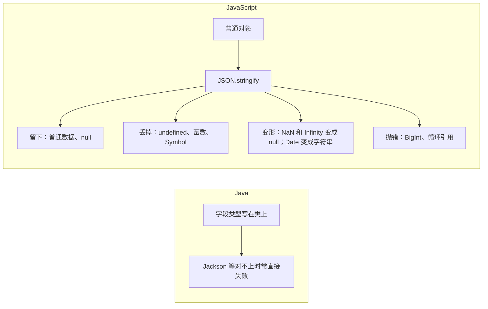

# 模块七：对象、JSON 与解构——前后端交互的高频静默错误

### 和其他语言的对照

对象里的 `undefined` 字段会被丢掉；数组里的 `undefined` 会变成 `null`。两种"没有"到了 JSON 里不是同一种结果。Java 同事若用 Long 的 JSON 数字对接，精度问题在第 3 次模块六已经讲过，这里只提醒：长 id 在契约里用字符串。

### 子话题

- **JSON 的坑**：
  - 自定义序列化用对象的 `toJSON`；自定义反序列化用 `JSON.parse(text, reviver)`。
  - `JSON.parse` 的 `__proto__` 键在现代引擎中不会直接污染原型，但深合并解析结果时仍可能引入原型污染。知道风险即可。
  - > **一句话守则**：JSON 不是 JS 对象的完整镜像，序列化前先问"哪些字段会消失或变形"。
- **解构、展开、可选链、空值合并**：
  - 解构 `null` / `undefined` 会抛错：`const { a } = null` 直接 `TypeError`。对上 Java 的拆箱空指针，但这里是解构这一步就抛。
  - 默认值只在 `undefined` 时生效：`const { a = 1 } = { a: null }` 得到 `null`，不是 `1`。
  - 展开是浅拷贝：嵌套对象仍是共享引用。
  - `?.` 只停在写了问号的那一层。`obj?.a.b` 在 `obj` 为空时得到 `undefined`；若 `obj` 有值而 `a` 是 `null`，读 `.b` 仍会抛。要逐级写成 `obj?.a?.b`。
  - `??` 与 `||`：`||` 把 `0`、`""`、`false` 也换成右边；`??` 只在 `null` 和 `undefined` 时才换。`0 ?? 1` 是 `0`，`0 || 1` 是 `1`。
