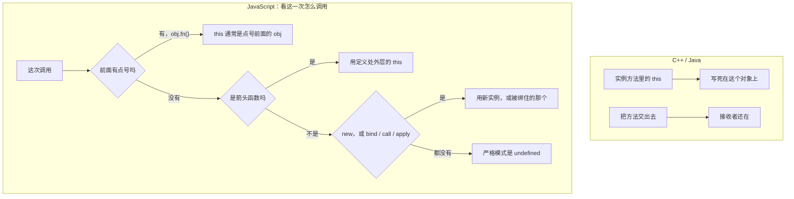

# 模块三：this——它不指向"当前对象"，它取决于"谁调用"

这是 C++/Java 同事最容易出现系统性误解的地方。在 Java/C++ 中，`this` 在实例方法中含义明确，就是当前实例；JS 的 `this` 由调用方式在运行时决定。

### 和其他语言的对照

经典对照就放在这张图上讲：`setTimeout(obj.method, 100)` 把方法单独递进去，点号没了，`this` 丢了。Java 的方法引用不会丢掉接收者。

### 子话题

- **四种绑定规则**（按优先级从高到低，图里已经是提问顺序，不必背）：`new` 绑定 → 显式 `bind` / `call` / `apply` → 方法调用 `obj.fn()` 中的 `obj` → 默认绑定（严格模式下 `undefined`，非严格模式下全局对象）。
- **丢失 this 的经典场景**：`setTimeout(obj.method, 100)`。修法是箭头函数包一层，或事先 `bind`。不要为了讲规则再写第四种写法。
- **箭头函数是"解药"也是"特例"**：箭头函数没有自己的 `this`，它捕获定义时外层作用域的 `this`。用它写回调通常能绕开绑定问题，但不要用箭头函数定义对象方法——此时 `this` 不会指向该对象。

**讲授策略**：反复问"这个函数被调用时，前面有点号吗？"
