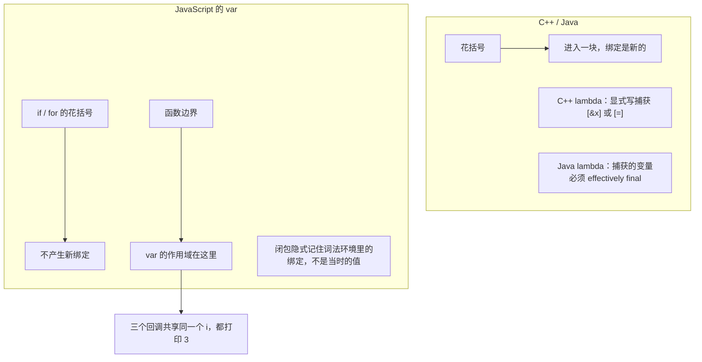

# 模块二：变量、作用域与闭包——var 是一场"函数级幻觉"


**核心反差**：C++/Java 的 `{}` 创造块级作用域；`var` 不认 `{}`，只认函数边界。`if` 和 `for` 的花括号在 `var` 面前几乎是装饰性的。

### 和其他语言的对照



左边强调"你得写明捕获什么"。右边强调"不写也会记住，而且记住的是那一个变量，不是一份拷贝"。

### 子话题

- **词法作用域 + 作用域链**：
  - 变量去哪找，由函数**写在哪**决定，不由**在哪调用**决定。函数定义时就记下了外层环境，这叫词法作用域（静态作用域）。
  - 查找规则：从当前作用域开始，逐层往外，直到全局；遇到第一个同名绑定就停。这一串从内到外的环境就是**作用域链**。
  - 对 C++/Java 同事：这和 C++/Java 的名字解析一样，"写在哪就绑哪"。区别在报错时机：JS 找不到名字是运行时 `ReferenceError`，不是编译失败。
  - 反例锚点：动态作用域是沿调用栈找变量。JS 不是这样。如果是，`show()` 会读到 `caller()` 里的 `x`。
  - 遮蔽：内层的 `let x` / `const x` 遮住外层同名绑定，外层不受影响。
  - 别和 `this` 混：`this` 看调用点，作用域链看定义点。
  - 对接闭包：闭包 = 函数 + 它定义时那条作用域链。闭包能读到外层变量，靠的就是这条链还连着。
  - 隐式全局：给未声明的名字赋值，非严格模式会悄悄挂到全局对象上；严格模式（ES 模块、`class` 内、带 `"use strict"` 的文件）直接 `ReferenceError`。`typeof` 对未声明的名字不报错，返回 `"undefined"`，会把"没声明"伪装成"值是 undefined"。
  - > **一句话守则**：变量看定义处，不看调用处；找不到就是 `ReferenceError`，不要靠隐式全局补救。
- **变量提升**：`console.log(x)` 在 `var x = 1` 之前输出 `undefined`，而不是报错。声明被"提升"了，赋值没有。
- **经典闭包循环陷阱**：

  ```js
  for (var i = 0; i < 3; i++) {
    setTimeout(() => console.log(i));
  }
  ```

  输出三个 `3`，因为三个回调共享同一个 `i`。用 `let` 后每次迭代创建新绑定，输出 `0, 1, 2`。这个例子直接现场演示。

- **let / const 的暂时性死区**：在声明之前访问 `let` / `const` 变量会抛 `ReferenceError`，而不是 `undefined`。这比 `var` 更接近他们的静态语言直觉，但报错时机仍然是运行时。
- **闭包：从"循环陷阱"升级为系统概念**：
  - 闭包捕获的是变量绑定，不是值。循环陷阱的本质是三个回调共享同一个 `i` 绑定，而不是"闭包记住了旧值"。
  - 工程含义：闭包可以做私有状态、模块模式、柯里化；但也容易导致内存泄漏——定时器、事件监听、缓存如果闭包持有了大对象，GC 回收不掉。
  - > **一句话守则**：闭包不是魔法，是函数记住了它定义时的作用域；需要"每次迭代独立"时，用 `let` 或显式工厂函数。
- **const 不是 C++ 的 const，也不是 Java 的 final**：
  - `const obj = {}` 之后 `obj.x = 1` 完全合法。`const` 只冻结绑定，不冻结值。
  - 要冻结对象内容用 `Object.freeze(obj)`，但它是**浅冻结**：嵌套对象仍可改。深冻结需要递归或库。
  - 属性还有 `writable` / `enumerable` / `configurable` 三个描述符，`Object.defineProperty` 可以精细控制；`Object.seal` 禁止增删属性但允许改值；`Object.preventExtensions` 只禁止新增。本讲只提名字，不演示。
  - 对比锚点：Java 的 `final` 字段如果指向对象，对象内容同样可变，但 Java 有 `Collections.unmodifiableList` 等包装；JS 没有编译期约束，全靠运行时 API 和约定。
- **arguments 与剩余参数**（一句）：`arguments` 是类数组，箭头函数没有它；剩余参数 `...args` 是真数组。新代码用剩余参数。

> **一句话守则**：新代码中默认 `const`，需要重新赋值时用 `let`，不要再用 `var`。
