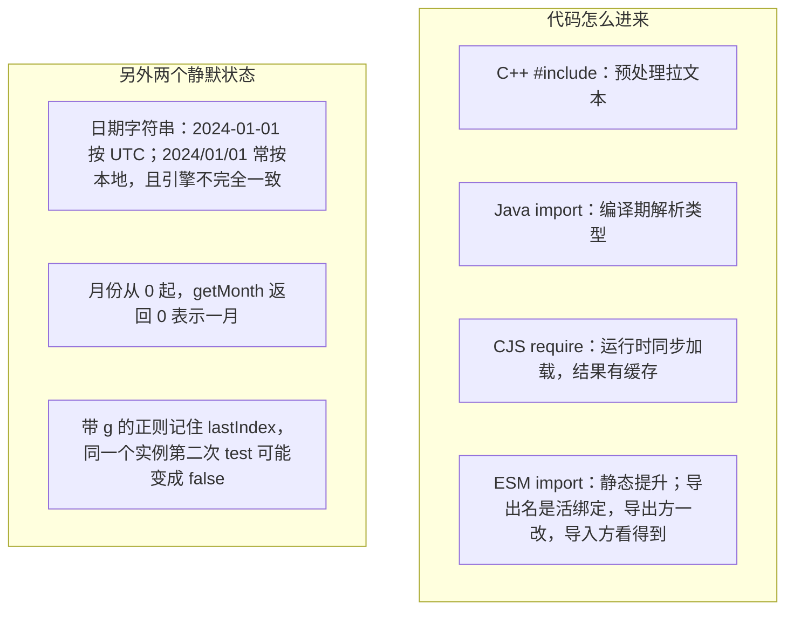

# 模块八：模块系统、日期与正则——其他高频坑

### 和其他语言的对照

### 子话题

- **模块系统**：
  - CommonJS：`module.exports` 和 `exports` 起初指向同一对象，把 `exports` 重新赋值为另一个对象会断开。顶层 `this` 是 `module.exports`。
  - ESM：顶层 `this` 是 `undefined`；`import()` 动态导入返回 Promise。
  - `package.json` 的 `"type": "module"` 决定 `.js` 按 ESM 还是 CJS 解析。循环依赖时两者行为不同，ESM 可能拿到尚未初始化的绑定。
  - > **一句话守则**：新项目用 ESM；看到 `require` 和 `module.exports` 知道是 CJS；不要混用。
- **日期与正则**：
  - `Date` 对象可变，`setDate` 改的是原对象。日期用 ISO 字符串并写明时区，不要依赖无时区字符串的默认解析。
  - 带 `g` 的正则要么每次新建，要么用完把 `lastIndex` 设回 `0`。
  - > **一句话守则**：日期用 ISO 字符串加明确时区；正则带 `g` 时不要复用同一个实例做多次 `test`。

