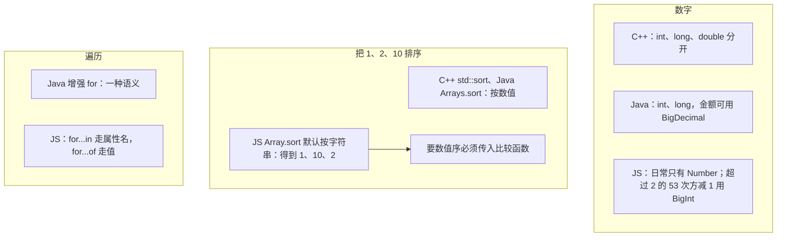

# 模块六：数字、数组与遍历——看起来一样，规则不一样

### 和其他语言的对照

`0.1 + 0.2 !== 0.3` 不是 JS 独有的，但 JS 没有开箱的小数类型，所以业务里直接看见。钱用整数分，或单独的 decimal 库，不要用 `Number` 做精确相等。

### 子话题

- **数字只有一种**：IEEE 754 双精度。超过 `2^53 - 1` 的整数会丢精度，需要 `BigInt`。
- **Array.sort() 默认按字符串排序**：`[1, 2, 10].sort()` 得到 `[1, 10, 2]`。数值序写 `(a, b) => a - b`。
- **突变方法 vs 不可变习惯**：`sort` / `reverse` / `splice` / `push` 会修改原数组；ES2023 的 `toSorted` / `toReversed` / `toSpliced` 返回新数组。业务代码优先用不改原数组的写法。
- **for...in vs for...of**：
  - `for...in` 遍历可枚举属性名，包括原型链上的，顺序不要依赖。不要用它遍历数组。
  - `for...of` 遍历可迭代对象的值：数组、字符串、`Map`、`Set`、生成器。
  - 遍历普通对象用 `Object.keys` / `Object.values` / `Object.entries`。
  - > **一句话守则**：数组和可迭代对象用 `for...of`，对象用 `Object.entries`，`for...in` 基本只在调试时用。
- **稀疏数组**（一句）：`Array(3)` 是三个空槽，不是三个 `undefined`；`map` 会跳过空槽。要三个 `undefined` 用 `Array.from({ length: 3 })`。
