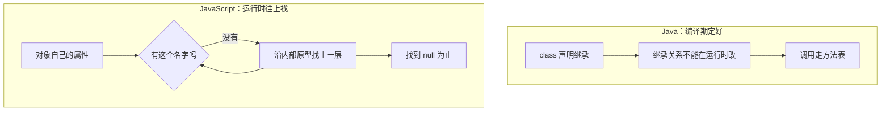

# 模块四：原型——不是"类"的语法糖（至少不完全是）

Java 的继承是编译期的类型扩展；JS 的原型查找是运行时的属性查找链。即使 ES6 引入了 `class` 语法，底层仍然是原型，而且运行时可以修改原型链。

### 和其他语言的对照

空对象不空，就是因为右边这条链的底是 `Object.prototype`，上面有 `toString`、`hasOwnProperty`。所以不要拿 `{}` 当哈希表，字典用 `Map`。

### 子话题

- **`obj.foo` 的查找路径**：先找自身属性，找不到沿 `[[Prototype]]` 向上找，直到 `null`。JS 的属性也是动态查找，运行时可以增删。
- **new 被省略时会发生什么**：非严格模式下，普通构造函数里的 `this` 会绑到全局对象，而不是新对象。这是又一个"不报错但静默出错"的典型。`class` 不用 `new` 调用会直接抛错，不要和旧构造函数混成一句。
- **为什么"空对象不空"**：`{}` 继承了 `Object.prototype`。键值对照用 `Map`。
- **class 的补充**（点名，不展开）：
  - `#private` 字段是真正的私有，不是 `_` 约定；`static` 块可以初始化静态字段；`new.target` 判断是否用 `new` 调用。
  - class 仍然是原型糖，运行时可以改原型，`instanceof` 走原型链。

本讲原型只要求三句：沿链找、别漏 `new`、字典用 `Map`。
